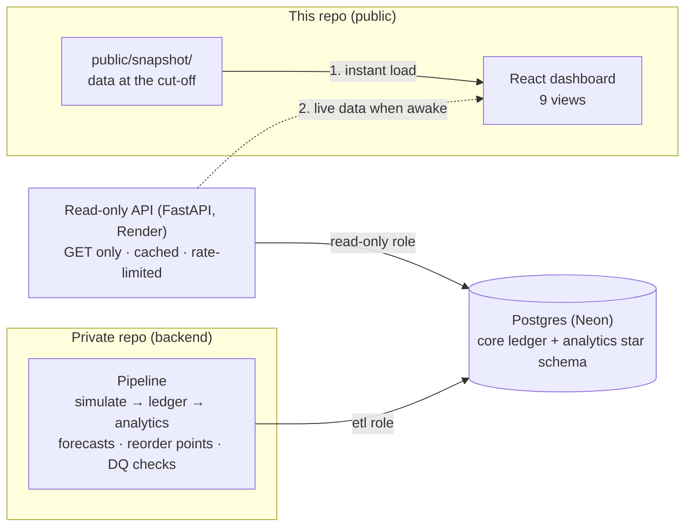

# Retail Inventory Management Dashboard

An interactive "control tower" for multi-warehouse, multi-store retail inventory. It pulls stock positions, replenishment, purchasing, goods receipt, inter-site transfers and supplier performance into a single screen — the kind of decisions normally spread across several ERP modules and a pile of spreadsheets.

**Live demo:** https://avixd.github.io/retail-inventory-app/

> **Demo project.** All data is synthetic and generated for demonstration; it does not represent any real company, supplier or system. The public site is view-only: action buttons are disabled and nothing a visitor does is stored or sent. Figures are in Canadian dollars (CAD).

> **Data: 24 months of simulated history, frozen at 31 Oct 2026.** The numbers come from a Postgres backend: an append-only stock ledger, demand forecasts and statistical reorder points, served through a read-only API. The site ships a snapshot of that data, so it loads instantly and never depends on a server being awake; nothing a visitor does changes the database. Backend code is in a private repository (available on request); its design, security and cost documentation is public in [docs/backend/](docs/backend/README.md).

## The business problem

In a growing retailer, the questions that decide margin and availability are simple to ask and hard to answer quickly:

- What is about to run out, and what should I reorder today?
- How much capital is sitting in back-of-house and warehouse reserve rather than on the shelf?
- Where are my purchase orders stuck, and how much do I owe suppliers and when?
- Which suppliers are actually earning their volume, and where is my spend concentrated?

In most operations those answers live in different systems (an ERP for stock, a separate procurement module, a finance ledger, a supplier scorecard someone maintains by hand). Pulling them together is manual, slow, and out of date by the time it is finished. The cost is real: overstocks tie up working capital, stockouts lose sales, and slow supplier decisions leave savings on the table.

## The solution

A single-page dashboard that unifies those questions into ten linked views over one shared data model, so a planner or analyst can move from a headline number to the underlying rows in a couple of clicks.

It opens on an **Executive Summary**: six findings for the month-end, each with a money or rate figure, the change since the previous month-end, a one-line takeaway and a link to the view that explains it. An **As of** selector in the header replays the whole dashboard at any of the last twelve month-ends.

| Area | View | What it answers |
|---|---|---|
| Overview | Executive Summary | Inventory investment, sales at risk, stock-out rate, network GMROI, supplier concentration and overdue payables, each vs the prior month-end; 12-month trend |
| Overview | Inventory Overview | On-hand trend, inventory value at cost and retail, split by category and location |
| Overview | Reorder / Low-Stock | Which SKUs are at or below reorder point, and the suggested PO value to cover them |
| Inventory | Off-Shelf · Warehouse | Reserve stock, warehouse floor map with bin fill levels, and capital tied up off the shelf |
| Inventory | Stock Movements | Recent inbound, outbound and adjustment activity |
| Procurement | Orders · Procure-to-Pay | PO pipeline by lifecycle stage, cycle time, outstanding payables, and a raise-a-PO flow |
| Procurement | Goods Receipt | Post goods receipt notes (GRNs) against open POs |
| Procurement | Transfer Orders | Inter-site stock transfers and their status |
| Master Data | Suppliers & Products | Vendor and SKU master data with cost, price and margin |
| Master Data | Supplier Performance | Weighted scorecards, cohort segmentation, spend Pareto, and payment-terms / working-capital analysis |

## Solution approach

The design follows one principle: **model the domain once, render it many ways.**

1. **A single in-memory domain model** (`src/data/inventory.js`) holds the entities a retailer actually works with — warehouses and stores, suppliers, products, stock, storage bins, purchase orders, invoices, transfers, movements and goods receipts.
2. **Business logic lives as pure selector functions** over that model — reorder detection, supplier scoring, spend Pareto, PO lifecycle roll-ups, cycle time, warehouse bin capacity and fill tiers. The views never recompute this logic; they call a selector and render the result.
3. **Views are thin.** Each of the nine screens is a presentation layer that composes shared chart and table components. This keeps every number on screen traceable to exactly one function, which is what makes the app both testable and honest.

The full reasoning, including trade-offs and what a production version would change, is in [`docs/`](docs/).

## High-level architecture



The dashboard loads the committed snapshot first, then switches to the live API when it answers; a badge in the header says which ("Snapshot · as of…" or "Live · as of…"). Views keep their original design: `hydrate()` replaces the in-memory model's contents with backend data, so every selector and chart runs unchanged on real volumes (60 SKUs, 8 sites, ~200k ledger rows). Twelve month-end snapshots, built offline from the deterministic simulation, let the dashboard show any of the last twelve month-ends without touching a database.

**Security posture:** this repo contains no secrets and needs none. The only network call the page may make is to the read-only API (enforced by a Content-Security-Policy). The API's database role can only `SELECT` from analytics views, with a read-only transaction default, query timeouts and connection limits. Details: [docs/backend/security.md](docs/backend/security.md).

## Tech stack

| Layer | Choice | Why |
|---|---|---|
| UI framework | React 19 | Component model suits nine views sharing one data source |
| Build tool | Vite 8 | Fast dev server and small production bundles |
| Charts | Recharts 3 | Declarative, composable React charts |
| Icons | lucide-react | Consistent, lightweight icon set |
| Type font | Inter (self-hosted) | No third-party font CDN call |
| Hosting | GitHub Pages via GitHub Actions | Free, static, auto-deployed on push |
| Backend (private) | Python 3.12, FastAPI, Postgres 16, numpy/pandas | Read-only API; forecasting and replenishment engines |
| Backend hosting | Render (API) + Neon (Postgres), free tiers | $0 with no payment method, so no bill is possible ([cost](docs/backend/cost.md)) |
| Testing | pytest, Node test runner | 48 API and 30 pipeline tests; front end: summary-maths unit tests, a check of every published month, and API contract tests |

## Documentation

Start at **[docs/README.md](docs/README.md)**.

| Document | Contents |
|---|---|
| [docs/backend/README.md](docs/backend/README.md) | End-to-end overview, good-practice alignment, pros and cons |
| [docs/backend/security.md](docs/backend/security.md) | Threat model, controls, breach-response playbook |
| [docs/backend/cost.md](docs/backend/cost.md) | Why it runs at $0 and what keeps it there |
| [docs/backend/high-level-design.md](docs/backend/high-level-design.md) · [low-level-design.md](docs/backend/low-level-design.md) | Requirements, schema, API contract, forecasting and replenishment maths |
| [docs/backend/adr/](docs/backend/adr/README.md) | Architecture decisions and why |
| [docs/architecture.md](docs/architecture.md) | Front-end data model, selectors and component hierarchy |
| [docs/technical-walkthrough.md](docs/technical-walkthrough.md) | Each view and the logic behind it |
| [docs/decisions.md](docs/decisions.md) | Front-end tools, assumptions and limitations |

## Run locally

```bash
npm install
npm run dev      # http://localhost:5173/retail-inventory-app/  (uses the committed snapshot)
npm run build    # static output in dist/, with the Content-Security-Policy injected
npm run test:unit # summary maths + every published month-end snapshot (offline)
npm run test:api  # contract tests against a running API (API_URL, default http://localhost:8000)
```

Running the backend too: [docs/backend/local-dev.md](docs/backend/local-dev.md).

## Licence

All rights reserved. This repository is published for **viewing and evaluation only** — see [LICENSE](LICENSE). Please do not copy, modify, redistribute or reuse the code or assets without permission.
