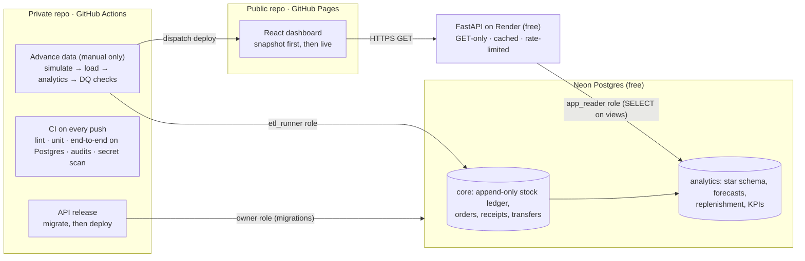

# Retail Inventory Platform: end-to-end overview

A retail inventory "control tower" built as a small production system: a public dashboard on GitHub Pages, a read-only API, a Postgres system of record with an analytics layer, and a pipeline that simulates a multi-site retailer and runs forecasting and replenishment. All data is synthetic. Running cost: **$0** ([cost.md](cost.md)).

This is the **private** backend repository. The dashboard lives in the public [`retail-inventory-app`](https://github.com/avixd/retail-inventory-app) repo and reaches the backend only through the read-only API ([ADR 0006](adr/0006-private-backend-repo.md)).

## How it works

1. **The data is frozen at a cut-off date (31 Oct 2026).** Twenty-four months of history were simulated day by day (sales, purchase orders, receipts, transfers) into an append-only stock ledger, then the analytics layer, 300 SKU-location forecasts and reorder points were computed. Eight data-quality checks gate every load; any failure rolls it back. Nothing changes the database on a timer or on deploy; moving the cut-off is a deliberate, manual step ([ADR 0007](adr/0007-frozen-dataset-cut-off.md)).
2. **The API** serves the analytics layer, read-only, with ETags, a 15-minute response cache and gzip.
3. **The dashboard** opens on an **Executive Summary**: six findings for the month-end (inventory investment, sales at risk, stock-out rate, GMROI, supplier concentration, overdue payables), each compared with the month before and linked to the view that explains it. An **As of** selector in the header shows the business at any of the last twelve month-ends, from snapshots built offline ([ADR 0008](adr/0008-month-end-history-snapshots.md)). The latest month can also come live from the API; a badge shows which ("Snapshot", "History" or "Live").

## Documents

| Document | Answers |
|---|---|
| [business-review.md](business-review.md) | **Start here (business):** the problem, USP, what the concept implies, real-life applications, honest critique, path to production |
| [option-analysis.md](option-analysis.md) | Which platform, and why |
| [high-level-design.md](high-level-design.md) | Requirements, architecture, data flow |
| [low-level-design.md](low-level-design.md) | Schema, API contract, forecasting and replenishment maths, pipeline, CI/CD (as built) |
| [data-pipeline.md](data-pipeline.md) | **End to end:** generate → ledger → analytics → checks → API/snapshots → screen; trace any number; release new data |
| [data-dictionary.md](data-dictionary.md) | Every table, view and column, generated from the schema's own comments |
| [security.md](security.md) | Threat model, controls, least privilege, **breach response playbook** |
| [cost.md](cost.md) | Free-tier limits, usage, guardrails, why it can't bill |
| [adr/](adr/) | Decisions made during the build and why |
| [setup-guide.md](setup-guide.md) | One-off account and secret setup (browser only, ~20 min) |
| [runbook.md](runbook.md) | Day-to-day operation and incidents |
| [local-dev.md](local-dev.md) | Running the full stack on one machine, and the test suites |
| [project-plan.md](project-plan.md) | Milestones and status |

## Alignment with good practice

| Area | Practice | Where |
|---|---|---|
| Data modelling | Append-only ledger as the source of truth; stock is derived, never overwritten. Separate star schema for analytics | Migrations 0001-0002 |
| Security | Least-privilege database roles enforced by Postgres, not just code; secrets only in secret stores; defence in depth (GET-only routes + read-only role + read-only transactions) | [security.md](security.md) |
| Reliability | Transactional, data-quality-gated loads; a fixed cut-off so every visit sees the same, reproducible data; migrations always run before a deploy; static snapshot fallback | `nightly.py`, `api-release.yml` |
| Testing | Unit, integration on real Postgres, end-to-end pipeline in CI, front-end contract tests against the live API | [local-dev.md §6](local-dev.md#6-tests) |
| Supply chain | Lockfiles, locked installs, dependency audits, Dependabot, pinned build image, secret scanning | `ci.yml`, `dependabot.yml` |
| Operability | Structured JSON logs with request IDs, job-run history in the database, runbook and playbooks | `observability.py`, [runbook.md](runbook.md) |
| Analytics rigour | Forecasts back-tested against a seasonal-naive baseline and reported honestly (30.9% vs 38.2% WAPE) | [ADR 0003](adr/0003-forecasting-in-numpy.md) |
| Documentation | Decisions recorded as ADRs; designs kept "as built" | [adr/](adr/) |

## Pros, cons and considerations

| | |
|---|---|
| **Pros** | Real, managed infrastructure end to end for $0. Public attack surface is a read-only API over synthetic data. Public site never depends on the backend being awake. Every layer is tested, and the design maps directly to paid tiers. |
| **Cons** | Free-tier cold starts (30-60 s; hidden by the snapshot). Monthly quotas are hard stops, so abuse can pause live data. Data is a fixed historical period, not live operations. Two repositories to keep in step. |
| **Considerations** | Synthetic data means no privacy obligations; real data would need RLS, audit and retention policies. Scaling up means paid tiers (always-on API, longer restore window) rather than redesign. Write paths (raising POs from the UI) exist only as a dev-only admin API and would need authentication before going public. |

## Code map

| Path | What's there |
|---|---|
| `backend/app/` | FastAPI service: config, DB access, response cache, problem+json errors, routes, models |
| `backend/migrations/sql/` | Schema as plain SQL: core, analytics, roles and grants, role limits |
| `pipeline/retail_pipeline/generate/` | Calendar, catalogue and the day-by-day retail simulator |
| `pipeline/retail_pipeline/analytics/` | ABC-XYZ, replenishment (SS/ROP/EOQ) and forecasting engines |
| `pipeline/retail_pipeline/{seed,nightly,dq}.py` | Backfill, manual advance job, data-quality checks |
| `.github/workflows/` | CI, manual data advance, API release, bootstrap (the Pages deploy lives in the public repo) |
