# Data pipeline: from simulated transactions to the number on screen

**Reviewed:** 03/11/2026 · How every figure in the dashboard is produced, checked and published, and how to trace any number back to its source rows.

## 1. End to end

```mermaid
flowchart LR
    subgraph Gen["1 · Generate (pipeline/)"]
        Cat["Catalogue<br/>60 SKUs · 12 suppliers · 8 sites<br/>promotions · holidays · bins"]
        Sim["Day-by-day simulator<br/>sales · POs · receipts · transfers · invoices"]
    end
    subgraph Core["2 · System of record (core)"]
        Led[("stock_movement<br/>append-only ledger")]
        Tx[("orders · receipts · transfers<br/>invoices · sales_daily")]
    end
    subgraph An["3 · Analytics (analytics)"]
        Facts[("facts: inventory daily · sales daily · PO lines<br/>dims: date · product · location · supplier")]
        Models[("models: ABC-XYZ · forecasts<br/>replenishment · KPIs")]
        Views["API views v_* and dataset views v_ds_*"]
    end
    DQ{{"4 · 11 data-quality checks<br/>(error = whole run rolled back)"}}
    subgraph Pub["5 · Publish"]
        API["Read-only API<br/>/api/v1/*"]
        Snap["Month-end snapshots<br/>12 × public/snapshot/&lt;date&gt;/"]
    end
    App["6 · Dashboard<br/>Executive Summary + 9 views"]

    Cat --> Sim --> Led & Tx
    Led & Tx --> Facts --> Models
    Facts & Models --> Views
    Views --> DQ --> API --> Snap --> App
    API -. "latest month, when deployed" .-> App
```



| Stage | Code | Input | Output | Runs |
|---|---|---|---|---|
| 1. Generate | `pipeline/retail_pipeline/generate/` | Seed number, start date | Rows for every core table, plus the simulator's future events (`ops.sim_plan`). `realism.py` adds product-level weekly demand shocks by volatility profile and the dated cost/price schedule ([ADR 0011](adr/0011-demand-realism.md), [ADR 0009](adr/0009-scd2-cost-price-history.md)) | `seed` once, then `nightly` per day |
| 2. Record | migrations 0001, 0009 | Generated rows (bulk `COPY`) | Normalised core tables; stock only ever changes by inserting ledger rows; cost/price changes append to `product_price_history` | Same transaction as stage 1 |
| 3a. Facts | `analytics.refresh_facts()` | Core tables | `fact_inventory_daily` (materialised), `fact_sales_daily` (COGS at the cost in force on the sale date), `fact_po_line`, `dim_*`, `dim_product_scd2` | Every load |
| 3b. Models | `pipeline/retail_pipeline/analytics/` | Facts | ABC-XYZ classes, 300 weekly forecasts with 80% intervals and back-test accuracy, reorder policy per SKU-site, monthly KPIs per site | Every load (`--skip-analytics` to defer), or `analyze --as-of` |
| 4. Check | `pipeline/retail_pipeline/dq.py` | Everything above | `ops.dq_result`; any **error** rolls the run back | Every load |
| 5a. Serve | `backend/app/` | `analytics.v_*` only, as `app_reader` | JSON, `GET` only, ETag, cached, rate-limited | On request (when deployed) |
| 5b. Snapshot | `backend/app/export_snapshot.py`, `scripts/build-history-snapshots.sh` | The API, in-process | 11 JSON files per month-end, plus `index.json` | On release only |
| 6. Display | front end `src/data/` | Snapshot (or live API for the latest month) | Views and the Executive Summary | In the browser |

Data is **frozen at 31 Oct 2026** ([ADR 0007](adr/0007-frozen-dataset-cut-off.md)). Nothing runs on a schedule; opening the app never touches a database.

## 2. Data-quality gates

All eleven run inside the load's transaction, after the analytics, so a failure leaves the previous good state untouched.

| Check | Severity | Guarantees |
|---|---|---|
| `negative_on_hand` | error | No site holds negative stock of any SKU (ledger sums ≥ 0) |
| `negative_bin_stock` | error | No DC bin holds negative stock |
| `missing_sales_rows` | error | Every store × active SKU × day has a sales row (zero sales are recorded, not missing) |
| `receipts_exceed_ordered` | error | No PO line received more than was ordered |
| `inventory_fact_reconciles` | error | The inventory fact's latest day equals the ledger's on-hand, row for row |
| `sales_loaded_through_as_of` | error | Sales are loaded through exactly the simulated date |
| `open_po_without_plan` | warn | Every open PO has a pending simulator event, so none is stuck forever |
| `price_history_current` | error | Each product's current cost and price equal its latest dated version (SCD Type 2 integrity) |
| `price_history_coverage` | error | Every product has a cost/price version in force from the first day of history |
| `price_above_cost` | error | Every active product has a positive cost and sells above it (margin and GMROI depend on it) |
| `bin_over_capacity` | warn | No DC bin holds more than its capacity. Slots are sized from the replenishment policy at peak demand (catalogue v2), so this is ~0; brief spikes when demand runs above expectation are warned, not blocked |

## 3. Models, briefly

| Model | Method | Output used by |
|---|---|---|
| ABC-XYZ | A/B/C by cumulative share of trailing 12-month revenue (80/95/100%); X/Y/Z by coefficient of variation of weekly demand over 26 weeks (≤ 0.5 / ≤ 1.0 / above) | Service-level targets; product segments |
| Forecast | Per SKU-site series, candidates compared on a rolling-origin back-test (4 origins × 8-week horizon) (seasonal naive, simple exponential smoothing, Holt-Winters, Croston-SBA for intermittent demand); lowest WAPE wins. Promotions: demand = base × (1 + β × weekly discount), β estimated per series without look-ahead, removed before fitting and re-applied to planned promotion weeks ([ADR 0010](adr/0010-promotion-aware-forecasting.md)) | Forecast view (Phase 2); accuracy reported against the seasonal-naive baseline |
| Replenishment | Service level by ABC class (A 98%, B 95%, C 90%); safety stock = z·√(L·σd² + d²·σL²); reorder point = d·L + SS; EOQ = √(2·D·S / H) | Product reorder points, reorder queue, sales at risk |
| KPIs | Per site per month: turns, days of supply, GMROI, stock-out rate. Network: margin and COGS over store **and** DC inventory | Executive Summary, overview |

Details and maths: [low-level-design.md §4](low-level-design.md).

## 4. Trace any number

Every figure on screen comes from one function over one file, which comes from one API route over one view:

| On screen | Front end | File / route | SQL view |
|---|---|---|---|
| Inventory investment | `summary.js` → `inventoryInvestment` | `dataset.json` → `/api/v1/dataset` | `v_ds_stock`, `v_ds_products` |
| Sales at risk | `salesAtRisk` | `replenishment.json` → `/api/v1/replenishment/recommendations` | `v_replenishment` |
| GMROI, turns, stock-out rate | `monthKpis`, `kpiTrend` | `kpis-network.json` → `/api/v1/analytics/kpis/network` | `v_kpi_network_monthly` |
| Supplier concentration | `supplierConcentration` | `spend-pareto.json`, `scorecard.json` | `v_spend_pareto`, `v_supplier_scorecard` |
| Overdue payables | `payables` | `procurement-summary.json` → `/api/v1/procurement/summary` | `v_payables_by_terms` |
| KPI scorecard and targets | `kpiScorecard`, `dataDerivedTarget` | `kpis-network.json` | `v_kpi_network_monthly` |
| Forecast accuracy and bias | Demand Forecast view | `forecast-accuracy.json` → `/api/v1/forecast/accuracy` | `v_forecast_accuracy_series` |
| Forecast vs actual chart | Demand Forecast view | `forecast-network.json` → `/api/v1/forecast/network` | `v_forecast_network_weekly` |
| Replenishment plan | Replenishment Plan view | `replenishment.json` (all pages) | `v_replenishment` |
| ABC-XYZ matrix | Inventory Health view | `abc-xyz.json` | `v_abc_xyz` |
| Site KPIs | Site Performance view | `kpis.json` | `v_inventory_kpis` |
| Service-level simulator | `serviceLevelAnalysis` | `replenishment.json`, `dataset.json` | `v_replenishment`, `v_ds_products` |
| Working capital | `workingCapital` | `dataset.json`, `replenishment.json`, `procurement-summary.json`, `kpis-network.json` | `v_ds_*`, `v_replenishment`, `v_payables_by_terms`, `v_kpi_network_monthly` |
| Data trust panel | Executive Summary | `data-quality.json` → `/api/v1/data-quality` | `v_data_quality` (latest **successful** load) |
| Reorder queue, overview, P2P, suppliers | `inventory.js` selectors | `dataset.json` | `v_ds_*` |

Column-level definitions: [data-dictionary.md](data-dictionary.md) (generated from the schema's own comments). KPI definitions, the KPI tree and target rules: [metrics.md](metrics.md) (generated from `metrics/metrics.toml`).

## 5. Releasing new data

One command, run against a **local** database (it truncates and rebuilds it; it refuses any other host):

```bash
scripts/release-data.sh ../retail-inventory-app
```

It migrates, rebuilds twelve month-ends from the seed, replaces the front end's `public/snapshot/`, regenerates the data dictionary and runs the front end's snapshot tests. Nothing is committed: review the diff in both repos, then commit. Because the simulator is deterministic, the same code and seed always produce the same data.

The same rebuild runs in CI without anyone's machine: **Actions → Data release → Run workflow** produces the snapshots as a downloadable artifact (`.github/workflows/data-release.yml`).

**Provenance.** Each month's `manifest.json` records the export time, the data as-of date, the file contract version, the API version, the git commit that produced it (marked `-dirty` if uncommitted) and a **SHA-256 checksum per file**. The front end's tests recompute every checksum, so a corrupted or hand-edited file fails CI.

To move the cut-off itself, change `DATA_CUTOFF` in `pipeline/retail_pipeline/generate/history.py` first.

## 6. How it's tested

| Layer | Tests | Where |
|---|---|---|
| Generator and models | 29: determinism, ledger/bin reconciliation, calendar, save-reload-continue equivalence, model maths | `pipeline/tests/` |
| SQL and API | 42 on a real Postgres: every endpoint, read-only role, network KPIs ≤ store average | `backend/tests/`; CI runs the full seed → advance → API path |
| Published data | Every month-end: files complete and dated, model hydrates, every selector and summary metric finite | front end `npm run test:unit` |
| Contract | Live API returns every field the views use; read-only; security headers; CORS | front end `npm run test:api` |

## 7. Best-practice alignment

| Practice | How it's met |
|---|---|
| Idempotent, transactional loads | Each load is one transaction; re-running the advance job after the cut-off is a no-op; a failed blocking check rolls everything back |
| Deterministic, reproducible data | Seeded simulator; the same code and seed rebuild identical history; tested |
| Schema as code, versioned | Alembic migrations 0001-0008 run in CI on every push; catalogue version guards the simulator |
| Data contracts | Front-end contract tests against the API; snapshot tests on every published month; contract version in each manifest |
| Data quality as gates, not reports | 11 checks inside the load; blocking checks roll back; results published per month |
| Single definition of each metric | `metrics/metrics.toml` → generated `metrics.md`; CI validates the KPI tree |
| Self-documenting schema | Every table and view carries a `COMMENT`; the data dictionary is generated and checked in CI |
| Least privilege along the pipeline | Generator, loader and reader run as different roles; the ledger is insert-only for the loader |
| Model governance | Back-test before selection; accuracy and bias reported against a naive baseline, pooled exactly; known gaps stated (promotions) |
| Provenance | Git SHA and per-file SHA-256 in every manifest; verified by tests |
| No single person or machine required | Data release runs in CI as well as locally |
