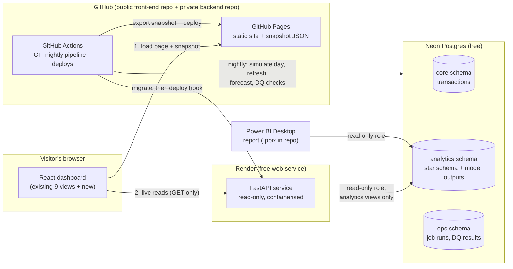
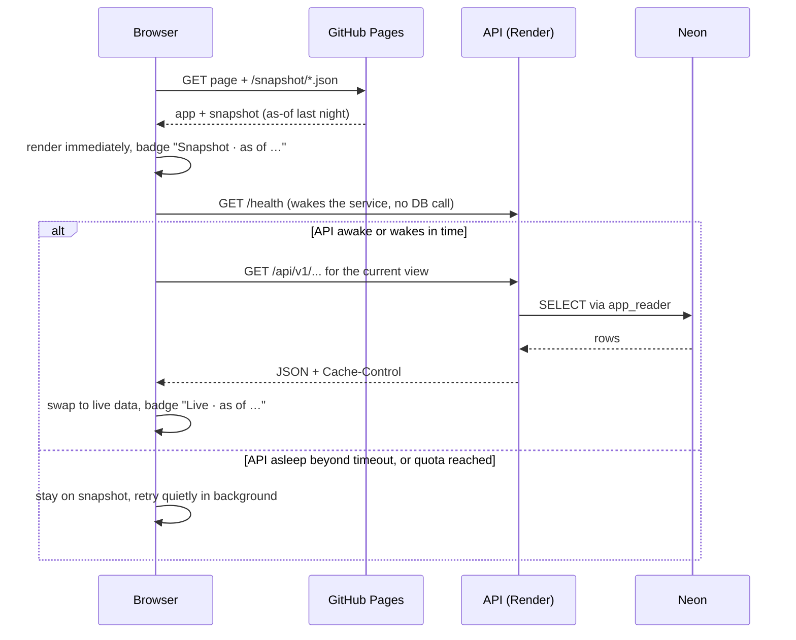
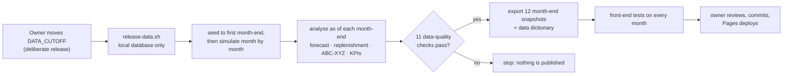

# High-level design and requirements

Status: **draft for review** · Date: 02/11/2026 · Scope: Phases 1 and 2

This document says *what* the backend must do and *how the pieces fit*. Table definitions, endpoint contracts and formulas are in [low-level-design.md](low-level-design.md); sequencing is in [project-plan.md](project-plan.md); the platform decision is in [option-analysis.md](option-analysis.md).

## 1. Context

Today the dashboard is a front end with hard-coded data. Every number comes from `src/data/inventory.js`, nothing persists, and the data never changes. That made it safe to publish but limits what it can prove. The backend replaces the hard-coded module with a real database, an API and a nightly data pipeline, and adds the retail analytics a planning team would actually use.

Decisions already made:

| Decision | Choice |
|---|---|
| Platform | Python FastAPI on Render (free) + Neon Postgres (free); front end stays on GitHub Pages |
| Scope | Phase 1 (working backend for the nine existing views) + Phase 2 (analytics layer, replenishment, forecasting, Power BI) |
| Public access | Strictly read-only. No write endpoints in production; the production API holds a read-only credential |

## 2. Business requirements

The system exists to answer the questions a retail inventory and procurement team asks every week. Each one maps to a measurable output.

| ID | Business question | Output that answers it | Phase |
|---|---|---|---|
| BR-01 | Where do we stand on stock and inventory value? | On-hand units, value at cost and retail, by category and location, with trend | 1 |
| BR-02 | What do we need to reorder, how much, and what will it cost? | Replenishment recommendations: reorder point, safety stock, order quantity, value | 1 (rule-based), 2 (statistical) |
| BR-03 | How much capital is tied up off the shelf, and where? | Reserve stock value by DC, bin utilisation map | 1 |
| BR-04 | Where are purchase orders in the pipeline, and what do we owe? | PO value by lifecycle stage, cycle time, payables by terms | 1 |
| BR-05 | Which suppliers earn their volume? | Supplier scorecard computed from delivery and receipt history, cohort, spend Pareto | 1 (ported), 2 (derived from transactions) |
| BR-06 | What will we sell over the next eight weeks? | Weekly demand forecast per SKU and store with intervals and measured accuracy | 2 |
| BR-07 | Which items deserve the most planning attention? | ABC (value) × XYZ (demand variability) classification | 2 |
| BR-08 | Is inventory working hard enough? | Turns, days of supply, GMROI, stockout rate, aged stock | 2 |
| BR-09 | Can leadership see this outside the app? | Power BI report on the same analytics layer | 2 |

## 3. Functional requirements

| ID | Requirement | Traces to |
|---|---|---|
| FR-01 | Store retail master and transactional data in Postgres: locations, suppliers, product hierarchy, stock movements, bins, purchase orders and lines, goods receipts, transfers, supplier invoices, daily sales | BR-01 to BR-05 |
| FR-02 | Derive stock on hand from an append-only movement ledger, not from a stored balance | BR-01 |
| FR-03 | Generate 24 months of realistic synthetic history (two full seasonal cycles, the minimum for weekly seasonal forecasting), with seasonality, promotions, Canadian holidays and lead-time variability, from a seeded, repeatable generator | All |
| FR-04 | ~~Advance the data by one simulated day every night~~ **Superseded 03/11/2026** ([ADR 0007](adr/0007-frozen-dataset-cut-off.md)): data is frozen at a cut-off date; advancing it is a manual, deliberate release | All |
| FR-05 | Expose read-only JSON endpoints covering everything the nine existing views display, with filtering and pagination | BR-01 to BR-05 |
| FR-06 | Publish static JSON snapshots with the front end: twelve month-ends up to the cut-off, built offline by `scripts/release-data.sh` ([ADR 0008](adr/0008-month-end-history-snapshots.md)) | NFR-04 |
| FR-07 | Front end loads the snapshot first, then switches to live API data when available, and shows which source and as-of time is on screen | NFR-04 |
| FR-08 | Front-end action buttons (raise PO, post GRN, create transfer) are visibly disabled as "view-only demo" in production | NFR-02 |
| FR-09 | Admin write endpoints for POs, GRNs and transfers exist in code, are tested, and run only in local/dev environments | Engineering depth |
| FR-10 | Star-schema analytics layer (dimensions and facts) built from the transactional data and refreshed nightly | BR-06 to BR-09 |
| FR-11 | Replenishment engine: safety stock, reorder point, economic order quantity, recommended order quantity, by SKU and location | BR-02 |
| FR-12 | Demand forecasting with an automatic model choice per series, backtested accuracy (WAPE), and stored forecasts with intervals | BR-06 |
| FR-13 | ABC-XYZ classification and inventory KPIs (turns, days of supply, GMROI, stockout rate) | BR-07, BR-08 |
| FR-14 | Supplier scorecard computed from PO, receipt and invoice history using the existing six weighted criteria | BR-05 |
| FR-15 | New front-end view: Forecast & Replenishment; KPI additions to existing views | BR-06 to BR-08 |
| FR-16 | Power BI report connected to the analytics layer through a read-only role; .pbix and screenshots committed | BR-09 |
| FR-17 | Data quality checks after every nightly run, with results stored and the job failing loudly on a breach | NFR-06 |
| FR-18 | Executive Summary landing view: six findings (inventory investment, sales at risk, stock-out rate, network GMROI, supplier concentration, overdue payables), each vs the prior month-end, with a takeaway, a drill-down link and its method | BR-01 to BR-08 |
| FR-19 | "As of" selector replays every view at any of the last twelve month-ends, on desktop and mobile, without a database call | BR-01, BR-07 |
| FR-20 | Network KPIs: GMROI and turns over store **and** DC inventory (per-site averages overstate GMROI ~7×) | BR-07, BR-08 |
| FR-21 | Data dictionary generated from schema comments; CI fails if it drifts | NFR-06 |
| FR-22 | Strategic KPI scorecard: GMROI north star decomposed as markup × turns, drivers and the stock-out guardrail, each against a data-derived target | BR-07, BR-08 |
| FR-23 | Planning views: demand forecast (accuracy and bias vs baseline, forecast vs actual), replenishment plan (every position, worked safety-stock example), inventory health (ABC-XYZ policy matrix), site performance | BR-02, BR-06 to BR-08 |
| FR-24 | Data trust: each month publishes the data-quality results of the load behind it | NFR-06 |
| FR-25 | Provenance: every snapshot manifest carries the git commit and a SHA-256 per file, verified by tests | NFR-06 |
| FR-26 | One metrics catalogue (`metrics/metrics.toml`) defines every KPI; documentation is generated and validated in CI | BR-01 to BR-09 |
| FR-27 | Cost and price history kept as SCD Type 2; sales COGS, margin and KPI inventory valuation use the cost in force on each date | BR-07, BR-08 |
| FR-28 | Forecasts model planned promotions as a lift on base demand; promotion-week accuracy reported with and without it | BR-06 |
| FR-29 | Simulated demand has realistic product-level variability (steady, variable, erratic profiles) | BR-02, BR-06 |
| FR-30 | Production monitor every 6 hours with alerting by GitHub issue; WCAG 2.0/2.1 A+AA audit enforced in CI | NFR-06, accessibility |
| FR-31 | Service-level simulator: per ABC class, safety-stock investment vs expected lost margin, cost-minimising level, what-if sliders | BR-02, BR-07 |
| FR-32 | Working-capital view: DIO, terms-weighted DPO, the self-financed gap, supplier-funded share, excess and aged stock | BR-03, BR-07 |

## 4. Non-functional requirements

| ID | Category | Requirement | How it's met |
|---|---|---|---|
| NFR-01 | Cost | $0 per month, with free-tier limits causing suspension, never a bill | Render Free, Neon Free, GitHub Pages on the public front-end repo, Actions on the private backend repo (well inside the 2,000 free minutes a month); no payment details on any account |
| NFR-02 | Security | No visitor can write data, reach credentials or reach the database directly | Read-only DB role in production, no write routes mounted, secrets only in platform settings, CORS allow-list, rate limiting |
| NFR-03 | Security | No secret in the repo, the browser bundle, logs or the snapshot | Secret scanning in CI, `.env.example` placeholders only, the API base URL is the only front-end config and is public by design |
| NFR-04 | Performance | First meaningful paint under 2 s even when the API is asleep; warm read endpoints p95 under 300 ms | Snapshot-first loading; HTTP caching; pre-aggregated analytics views |
| NFR-05 | Availability | Best effort, no SLA. The app must stay usable when the API or DB is asleep, suspended or over quota | Snapshot fallback with a visible "Snapshot · as of …" badge |
| NFR-06 | Data quality | No negative on-hand, no orphan foreign keys, nightly data present for every active store | Constraints in the schema plus post-run checks (FR-17) |
| NFR-07 | Maintainability | Reproducible setup; one command to run locally; migrations versioned | `uv` for Python dependencies, Alembic migrations, seeded generator |
| NFR-08 | Testability | Business logic covered by unit tests; API covered by integration tests against a real Postgres | pytest; ephemeral Neon branch per CI run |
| NFR-09 | Observability | Every request and job traceable | Structured JSON logs with request IDs; `ops.job_run` table; `/api/v1/meta` exposes data freshness |
| NFR-10 | Portability | No lock-in beyond standard Docker and Postgres | API ships as a container; plain SQL migrations; could move to Azure Container Apps or any Postgres host unchanged |
| NFR-11 | Free-tier fit | Stay inside 512 MB RAM (Render), 0.5 GB storage and 100 CU-hours (Neon) | Slim API image (no pandas or statsmodels in the API); heavy maths runs in the nightly pipeline; data sized to about 125 MB (see LLD §3.6) |

## 5. Architecture

### Components

| Component | Responsibility | Runs on |
|---|---|---|
| React dashboard | Presentation only. Loads snapshot, then live data; formats numbers; no business logic | GitHub Pages |
| FastAPI service | Validates requests, queries the database, shapes JSON, sets cache headers. Holds the read-only credential only | Render, Docker |
| `core` schema | Normalised transactional model; the system of record | Neon |
| `analytics` schema | Dimensions, facts, and model outputs (forecasts, replenishment, classifications); what the API and Power BI read | Neon |
| `ops` schema | Job runs, data-quality results, audit log for dev-only writes | Neon |
| Nightly pipeline | Python jobs: simulate a day, refresh analytics, run forecasts and replenishment, run DQ checks, export the snapshot | GitHub Actions |
| CI | Lint, type-check, unit and integration tests, secret scan, front-end build | GitHub Actions |
| Power BI report | Executive view of the analytics layer | Desktop; file committed to repo |

## 6. Security model

Security is layered so that a single mistake doesn't expose anything.

> Security controls and operating procedures for this part are documented internally.

## 7. Key flows

### 7.1 Page load

A sleeping Render service takes 30 to 60 seconds to start, so the visitor never waits on it: the snapshot is on screen first and the live data replaces it when ready.

### 7.2 Data release (replaces the nightly pipeline)

Nothing runs on a schedule and nothing writes to a database when someone opens the site ([ADR 0007](adr/0007-frozen-dataset-cut-off.md), [ADR 0008](adr/0008-month-end-history-snapshots.md)). Full detail: [data-pipeline.md](data-pipeline.md).

## 8. Environments

| Environment | Database | API | Purpose |
|---|---|---|---|
| Local | Neon `dev` branch (or optional local Postgres via Docker) | `uvicorn` on localhost, admin routes enabled | Development, including write paths |
| CI | Throwaway `postgres:17` container per run ([ADR-0002](adr/0002-ci-postgres-service-container.md)) | In-process test client | Roles, migrations, seed, nightly run and API tests against real Postgres |
| Production | Neon `main` branch | Render, admin routes disabled, read-only credential | Public demo |

CI never touches Neon: every run builds a fresh database from the migrations, so the schema, roles and grants are proven from scratch each time.

## 9. Constraints, assumptions and risks

**Constraints:** free tiers only; solo build; GitHub Pages stays the front-end host; deploy workflow currently targets the `master` branch.

**Assumptions:**

- Recruiter-level traffic (tens of visits a day at most). Neon's 400 hours a month at 0.25 CU covers this easily because the snapshot absorbs most page loads.
- Power BI deliverable is a `.pbix` file plus screenshots. Publishing to the Power BI Service needs a paid licence and isn't required.
- Render's free tier still needs no payment card when the account is created.

| Risk | Likelihood | Impact | Mitigation |
|---|---|---|---|
| Render asks for a card at sign-up (some community reports) | Low–medium | Blocks API hosting | API is a standard container; re-assess free container hosts at that point. The snapshot keeps the site working meanwhile |
| Free-tier terms change | Medium over 12 months | Possible suspension | Portable stack (NFR-10); snapshot fallback; terms re-checked in each phase review |
| Neon storage passes 0.5 GB | Low | Writes fail | Sized to about 125 MB; nightly job collapses history older than 30 months |
| Private-repo Actions minutes run out (2,000/month free) | Low | Nightly and CI pause until the month resets | Nightly uses ~5 min/day; CI cancels superseded runs; the site keeps its last snapshot |
| Render 512 MB memory exceeded | Low | API crashes | No data-science libraries in the API image; queries return pre-aggregated rows |
| GitHub cron runs late | High (minutes) | Snapshot a little stale | Acceptable; as-of time is shown on screen |
| Forecast accuracy looks poor on synthetic data | Medium | Weak demo | Generator encodes real seasonal patterns; accuracy is reported honestly against a seasonal-naive baseline |
