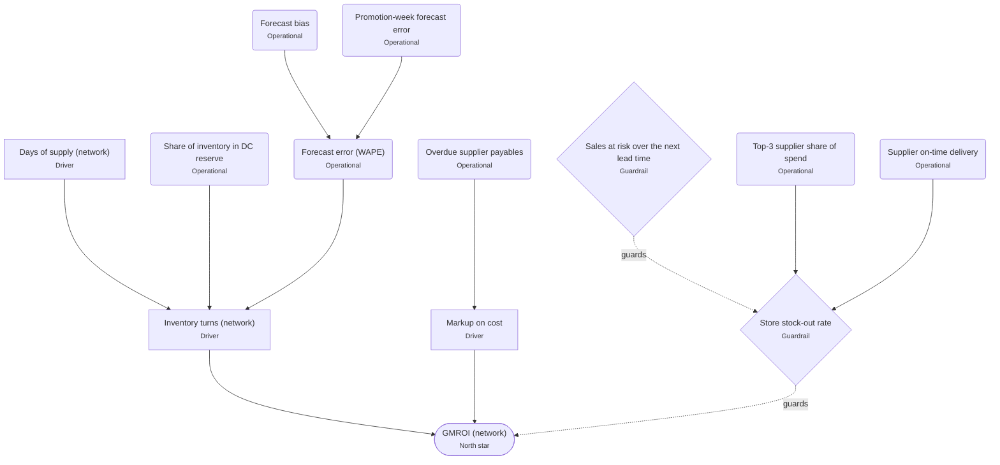

# Metrics and KPI tree

<!-- Generated by scripts/gen_metrics_doc.py from metrics/metrics.toml. Do not edit by hand. -->

Every KPI the dashboard shows, defined once. **North star: GMROI.** It decomposes exactly as
**GMROI = markup on cost × turns** (gross margin ÷ inventory = gross margin ÷ COGS × COGS ÷ inventory),
so it improves by earning more per unit or by holding less stock for the same sales. Availability is
the guardrail: GMROI must not be bought with empty shelves.

## Targets

Best rolling 3-month average of the metric over the trailing 12 month-ends: performance this business has already sustained, not a one-month spike or an outside benchmark. Status: on target if at or better than target; watch if within 10% of it; off target beyond that.

## Definitions

| KPI | Tier | Good when | Formula | Unit | Grain | Target | Owner |
|---|---|---|---|---|---|---|---|
| **GMROI (network)** | North star | higher | store gross margin / average daily inventory at cost across stores AND DCs x 365 / days in month | x (annualised) | month x network | data-derived (see above) | COO / Merchandising |
| **Inventory turns (network)** | Driver | higher | store cost of goods sold / average daily inventory at cost across stores and DCs x 365 / days | x (annualised) | month x network | data-derived (see above) | Inventory planning |
| **Markup on cost** | Driver | higher | gross margin / cost of goods sold (= GMROI / turns, an exact identity) | x | month x network | data-derived (see above) | Merchandising / Pricing |
| **Days of supply (network)** | Driver | lower | average inventory at cost / average daily cost of goods sold | days | month x network | data-derived (see above) | Inventory planning |
| **Share of inventory in DC reserve** | Operational | lower | units on hand at DCs x unit cost / all units on hand x unit cost, at the month-end | % | month-end x network | none (context) | Supply chain |
| **Forecast error (WAPE)** | Operational | lower | sum \|forecast - actual\| / sum actual over rolling-origin back-tests (4 origins x 8 weeks), pooled across store series; promotions modelled as a lift on base demand | % | forecast run x network | must beat the seasonal-naive baseline | Demand planning / Data science |
| **Forecast bias** | Operational | closer to zero | sum (forecast - actual) / sum actual over the same back-tests; positive = over-forecasting | % | forecast run x network | within +/- 5% | Demand planning / Data science |
| **Promotion-week forecast error** | Operational | lower | sum \|forecast - actual\| / sum actual over back-test weeks that had a promotion, with the promotion lift applied (also reported without it) | % | forecast run x network | must beat the same forecast without the promotion lift | Demand planning / Data science |
| **Store stock-out rate** | Guardrail | lower | store-SKU-days ending with zero on hand / all store-SKU-days in the month | % | month x network (also by store) | data-derived (see above) | Store operations |
| **Sales at risk over the next lead time** | Guardrail | lower | sum over positions OUT or BELOW reorder point of max(0, avg daily demand x mean lead time - on hand) x unit price | CAD | month-end x position (SKU x site) | none (trend vs prior month) | Inventory planning |
| **Top-3 supplier share of spend** | Operational | lower | year-to-date ordered spend with the three largest suppliers / all YTD ordered spend | % | month-end x network | none (risk context) | Procurement |
| **Supplier on-time delivery** | Operational | higher | received PO lines whose first receipt arrived on or before the expected date / all received PO lines, per supplier | % | supplier | none (scorecard cohorts) | Procurement |
| **Overdue supplier payables** | Operational | lower | sum of open supplier invoices past their due date | CAD | month-end x network | none (trend vs prior month) | Finance (AP) |

## Why each one matters, and where it's computed

| KPI | Why it matters | Computed in |
|---|---|---|
| GMROI (network) | Return on the inventory investment. Store-level GMROI ignores the DC stock behind each sale and overstates it about seven-fold. | `analytics.v_kpi_network_monthly -> /api/v1/analytics/kpis/network -> kpis-network.json` |
| Inventory turns (network) | Capital efficiency: the same sales on less stock lifts GMROI one for one. | `analytics.v_kpi_network_monthly` |
| Markup on cost | Margin per unit sold. Falls with deeper promotions or a mix shift to low-margin items. | `derived in src/data/summary.js from GMROI and turns` |
| Days of supply (network) | The flip side of turns, in days: how long current stock lasts at the current sales rate. | `analytics.v_kpi_network_monthly` |
| Share of inventory in DC reserve | Capital not yet on a shelf. High reserve with low store availability means stock is in the wrong place. | `dataset.json (stock, products) -> summary.js inventoryInvestment` |
| Forecast error (WAPE) | Better forecasts need less safety stock for the same service, which raises turns. | `analytics.v_forecast_accuracy_series -> /api/v1/forecast/accuracy` |
| Forecast bias | Persistent over-forecasting builds excess stock; under-forecasting causes stock-outs. Accuracy alone hides direction. | `/api/v1/forecast/accuracy` |
| Promotion-week forecast error | Promotions roughly double demand; missing them empties shelves in the weeks that matter most. | `analytics.forecast_accuracy (promo_* columns) -> /api/v1/forecast/accuracy` |
| Store stock-out rate | Guardrail on the north star: cutting stock to lift GMROI is only good if shelves stay full. | `analytics.v_kpi_network_monthly; analytics.inventory_kpi_monthly by site` |
| Sales at risk over the next lead time | Forward-looking: the revenue current stock can't protect before replenishment lands. | `replenishment.json -> summary.js salesAtRisk` |
| Top-3 supplier share of spend | Supply risk: one supplier slipping hits availability across many SKUs. | `spend-pareto.json -> summary.js supplierConcentration` |
| Supplier on-time delivery | Late suppliers inflate lead-time variability, which inflates safety stock. | `analytics.v_supplier_scorecard` |
| Overdue supplier payables | Late payment forfeits early-payment discounts and supplier goodwill, which erode margin and terms. | `procurement-summary.json -> summary.js payables` |
