# Backend project plan

Status: **build in progress** · Updated: 02/11/2026 · Scope: Phases 1 and 2

Sequencing, acceptance criteria and documentation steps for building the backend described in [high-level-design.md](high-level-design.md) and [low-level-design.md](low-level-design.md).

## Status at 02/11/2026

| Milestone | State | Evidence / what's left |
|---|---|---|
| M0.1 Design | ✔ Done | Option analysis, HLD, LLD, this plan |
| M0.2 Accounts + secrets | ⏳ Owner action | Follow [setup-guide.md](setup-guide.md) |
| M0.3 Scaffolding + CI | ✔ Pushed | Published to the private `retail-inventory-backend` repo 02/11/2026 ([ADR 0006](adr/0006-private-backend-repo.md)); stack verified end to end locally on Postgres 16 |
| M1 Schema, roles, migrations | ✔ Code done | 3 migrations + role guard; verified by CI end-to-end job |
| M2 Generator | ✔ Done, tested | 16 tests pass: determinism, ledger/bin reconciliation, calendar, supplier calibration, save-reload-continue equivalence |
| M3 Read API | ✔ Code done | 22 endpoints, unit + integration tests; integration runs in CI |
| M4 Deploy API | ⏳ Needs M0.2 | `render.yaml`, `api-release.yml` ready |
| M5 Front end on live data | ✔ Code done | Snapshot-first loading, status badge, view-only buttons |
| M6 Nightly pipeline | ✔ Code done | `nightly.yml`; needs M0.2 to run |
| M7 Phase 1 release | ◻ Open | After first deploy: security re-check, README update, tag v1.0 |
| M8-M11 Analytics engines | ✔ Done, tested | 13 analytics tests pass; backtest on generated data: 30.9% WAPE vs 38.2% seasonal naive |
| M12 Forecast & Replenishment view | ◻ Open | API endpoints exist; UI view not built yet |
| M13 Power BI | ◻ Open | Needs the live database |
| M14 Phase 2 release | ◻ Open | |

Code was verified in two ways. The generator and analytics maths ran here (29 tests). The SQL and API can only run against Postgres, so they're verified by the CI end-to-end job on the first push; expect that first run to surface fixes.

## 1. Working agreement

- **Every milestone ends the same way:** tests green, docs updated, security checklist passed, and your review before anything is pushed. Backend code goes to the private repo; only front-end changes go to the public one.
- **Building happens in the local project folder.** Pushing to GitHub stays your call.
- **Account creation and credentials are yours.** I'll give step-by-step instructions for creating the Neon and Render accounts, generating passwords and adding secrets, but I don't create accounts or type credentials.
- **Nothing chargeable.** Free tiers only, no payment details on any account. If a provider asks for a card, we stop and re-plan.
- Sizes below are relative (S, M, L), not time estimates.

## 2. Milestones

```mermaid
flowchart LR
    subgraph P0["Phase 0 · Foundations"]
        M01["M0.1 Design approved"] --> M03["M0.3 Repo scaffolding + CI skeleton"]
        M02["M0.2 Accounts + secrets<br/>(owner action)"]
    end
    subgraph P1["Phase 1 · Core backend"]
        M1["M1 Schema, roles, migrations"] --> M2["M2 Synthetic data generator"]
        M2 --> M3["M3 Read API (9 views)"]
        M3 --> M4["M4 CI on Neon branches + Render deploy"]
        M4 --> M5["M5 Front end on live data + snapshot"]
        M5 --> M6["M6 Nightly pipeline v1"]
        M6 --> M7["M7 Docs, security review, release v1.0"]
    end
    subgraph P2["Phase 2 · Analytics"]
        M8["M8 Star schema"] --> M9["M9 ABC-XYZ + replenishment"]
        M8 --> M10["M10 Forecasting + backtest"]
        M8 --> M11["M11 Scorecard + KPIs from transactions"]
        M9 --> M12["M12 Forecast & Replenishment view"]
        M10 --> M12
        M11 --> M12
        M12 --> M13["M13 Power BI report"]
        M13 --> M14["M14 Docs, case study, release v2.0"]
    end
    M03 --> M1
    M02 --> M1
    M7 --> M8
```

### Phase 0: Foundations

| ID | Milestone | Size | Done when |
|---|---|---|---|
| M0.1 | Option analysis, HLD, LLD and this plan approved | S | You sign off (or request changes) |
| M0.2 | **Owner action:** create free Neon and Render accounts; create the Neon project in the agreed region; generate role passwords; add GitHub Actions secrets | S | Secrets listed in LLD §5.4 exist; no card on either account |
| M0.3 | Scaffolding: `backend/` and `pipeline/` projects, `uv`, ruff, mypy, pytest, `.env.example`, `.gitignore` additions (`.env`, `public/snapshot/`), `ci.yml` with lint, unit tests and secret scan | S | CI green on an empty test suite; secret scan runs |

M0.3 and the logic for M2 don't need a database, so they can start while M0.2 is in progress.

### Phase 1: Core backend

| ID | Milestone | Size | Done when |
|---|---|---|---|
| M1 | `core`, `analytics` and `ops` schemas; tables and constraints (LLD §3.2); roles and grants (§3.4); Alembic baseline | M | `alembic upgrade head` runs clean on a Neon dev branch; test proves `app_reader` cannot insert |
| M2 | Synthetic data generator and seed (§3.5): 24 months, about 60 SKUs, deterministic | L | Same seed gives the same checksum; data-quality checks pass; database under 200 MB |
| M3 | Read API for all nine existing views (§5.2, Phase 1 rows), with caching, CORS, rate limit, problem+json errors and OpenAPI docs | L | Integration tests pass for every endpoint; warm p95 under 300 ms; no write route registered with the production config |
| M4 | Integration tests on ephemeral Neon branches in CI; `api-release.yml`; Render service with read-only credential | M | Public `/health` and `/docs` reachable; security tests pass against the deployed service |
| M5 | Front end: `client.js`, `useLiveData`, `DataStatus` badge, snapshot export, view-only action buttons; retire hard-coded selectors | M | Site works with the API off (snapshot) and on (live); badge shows the correct source; first paint under 2 s |
| M6 | `nightly.yml`: simulate day, refresh, data-quality checks, export snapshot, deploy | M | Three consecutive successful nightly runs; as-of date advances on the live site |
| M7 | Phase 1 documentation and security review; release `v1.0` | S | Docs in §3 updated; compliance re-check clean; tag pushed after your review |

### Phase 2: Analytics

| ID | Milestone | Size | Done when |
|---|---|---|---|
| M8 | Star schema: dimensions, `fact_inventory_daily`, `fact_po_line`, refresh job (LLD §3.3) | M | Inventory fact reconciles to the ledger in the data-quality checks |
| M9 | ABC-XYZ classification and replenishment engine (§4.1–4.4) | M | Unit tests match hand calculations; Reorder view switched to statistical recommendations |
| M10 | Forecasting with rolling-origin backtest (§4.5) | L | Forecasts for every series; WAPE and value added over seasonal naive reported honestly, including where the baseline wins |
| M11 | Supplier scorecard and inventory KPIs measured from transactions (§4.6–4.7) | M | Scores derived from history, not typed in; KPIs available through the API |
| M12 | New Forecast & Replenishment view; KPI cards on existing views | M | Works on snapshot and live |
| M13 | Power BI report on the analytics layer through `app_reader`. I write the model spec (relationships, DAX measures, page layout); **you** connect Power BI Desktop and enter the credential on your machine | M | `.pbix` and screenshots committed; no credential stored in the file or repo |
| M14 | Phase 2 documentation, case study, final security review; release `v2.0`; update portfolio card | S | As M7, plus the case study page |

## 3. Documentation steps

Docs are updated inside each milestone, not saved for the end.

| Document | Created / updated in | Content |
|---|---|---|
| `docs/option-analysis.md` | M0.1 ✔ | Platform decision and evidence |
| `docs/high-level-design.md` | M0.1 ✔, revised M7, M14 | Requirements, architecture, security model |
| `docs/low-level-design.md` | M0.1 ✔, kept as-built each milestone | Schema, API contract, maths, pipeline |
| `docs/adr/` | When a design decision changes | One short decision record per change (context, decision, consequences) |
| `docs/data-dictionary.md` | M1, M8 | Generated from `COMMENT ON` statements in migrations, so it can't drift from the schema |
| `docs/api-reference.md` | M3, M12 | Generated from the OpenAPI spec, plus example requests |
| `docs/runbook.md` | M4, M6 | Deploy, rotate secrets, re-run nightly, free-tier exhaustion |
| `docs/forecast-model-card.md` | M10 | Method, data, accuracy, known failure modes, limitations |
| `docs/security-review.md` | M7, M14 | Dated compliance checklist and results, same format as the pre-publish review |
| `README.md`, `docs/architecture.md`, `docs/technical-walkthrough.md`, `docs/decisions.md` | M7, M14 | Front-end-only descriptions replaced with the full-stack story |
| `CHANGELOG.md` | Each release | What changed, in plain English |
| Code comments | Every milestone | Same standard as now: purpose docblocks and comments on non-obvious logic only |

## 4. Security checklist (run at M4, M7, M14)

1. No secret in the repo, history, browser bundle, snapshot files or logs (secret scan plus manual grep).
2. Production API exposes `GET` only; `POST` to admin paths returns 404.
3. `app_reader` write attempt rejected by the database.
4. CORS rejects an unlisted origin; rate limit returns 429 under burst.
5. Error responses contain no stack traces, SQL or connection details.
6. Every account is still on a free plan with no payment method.
7. All data is synthetic; emails on `.example`.

## 5. Risks to the plan

Technical risks are in HLD §9. Plan-level risks:

| Risk | Mitigation |
|---|---|
| Render or Neon asks for a card at sign-up | Stop at M0.2 and re-plan; the API is a portable container |
| Scope creep in Phase 2 (more models, more views) | Phase 2 is capped at the items above; extras go to a Phase 3 backlog |
| Synthetic data that looks too clean | Generator deliberately includes intermittent SKUs, late suppliers, rejections and stockouts so the analytics have something real to find |

## 6. Phase 3 backlog (not in scope)

Promotions as a forecasting input; slowly changing dimensions (type 2); a Fabric mirror of the analytics layer; end-to-end browser tests; Application Insights-style tracing; multi-echelon inventory optimisation.
